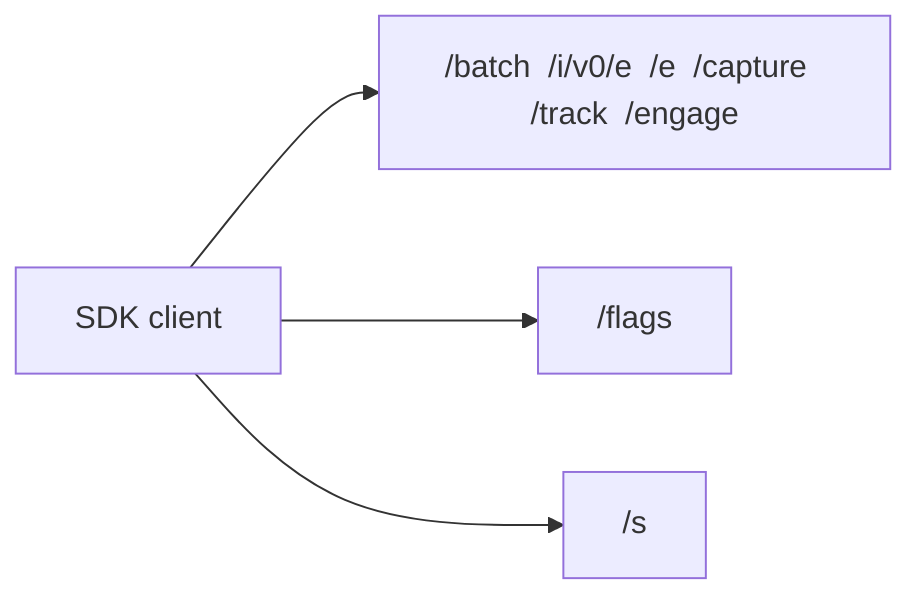
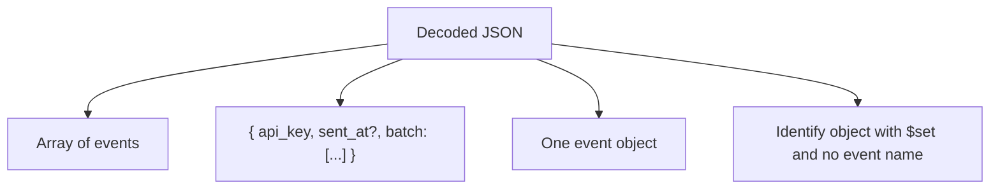

# PostHog capture API

PostHog SDK clients ingest events by HTTP against a capture host. The project token is the only credential. The host must not return project data.

Official reference: [Capture and batch API endpoints](https://posthog.com/docs/api/capture). The sections below also include what the current SDKs and the capture service actually accept, because that is wider than the examples on the docs page.

Cloud hosts are `https://us.i.posthog.com` and `https://eu.i.posthog.com`. A self-hosted or proxied install uses its own origin. Clients append the path themselves, usually with a trailing slash, so a host of `https://example.com` receives `POST /batch/`.

## Endpoints

One handler serves every analytics path. A trailing slash is optional. `GET`, `POST`, and `OPTIONS` are all accepted. `GET` exists for clients that cannot send a body and put the payload in the `data` query parameter.

| Path | Role |
| --- | --- |
| `/i/v0/e` | Current single-event path. The Rust SDK posts here. |
| `/batch` | Current batch path. Node, Python, and the other core SDKs post here. The browser SDK uses it for normal `fetch` calls. |
| `/e` | Legacy path. The browser SDK still uses it for `sendBeacon`. |
| `/capture` | Legacy alias of `/e`. |
| `/track` | Legacy alias of `/e`. |
| `/engage` | Legacy identify path. A body with no `event` name is stored as `$identify`. |
| `/i/v0/ai` and `/i/v0/ai/otel` | AI events. Not required for product analytics. |
| `/s` | Session replay. Separate from analytics, with a larger body limit. |
| `/flags` | Feature flags and remote config. `/decide` is the legacy name. |
| `/static/array.js` and the other `/static/*.js` files | First-party script loader. |



Analytics capture still runs when `/flags` fails. Replay and flags are separate products.

## Request shapes

After decompression, the JSON body is one of four shapes. The capture service tries them in this order: a raw array, a batch envelope, a single event, then an identify body that has no event name.



Single event:

```json
{
  "api_key": "<project token>",
  "event": "user signed up",
  "distinct_id": "user_123",
  "properties": { "plan": "pro" },
  "timestamp": "2024-04-03T12:00:00.000Z"
}
```

Batch:

```json
{
  "api_key": "<project token>",
  "historical_migration": false,
  "sent_at": "2024-04-03T12:00:10.000Z",
  "batch": [
    {
      "event": "clicked",
      "timestamp": "2024-04-03T12:00:00.000Z",
      "properties": { "distinct_id": "user_123", "source": "email" }
    }
  ]
}
```

Older browser clients send a raw JSON array of events. `/engage` may omit `event` and send `$set` at the top level.

## Event fields

| Field | Required | Notes |
| --- | --- | --- |
| `api_key` | Yes, on the event or the batch envelope | Also accepted as `token` and `$token`, including inside `properties`. Every event in one request must use the same token. |
| `event` | Yes, except on `/engage` | Missing name on `/engage` means `$identify`. |
| `distinct_id` | Yes | Also accepted as `$distinct_id`, and from `properties.distinct_id` when the top level is empty. The top level wins when both are set. Numbers and booleans are stringified. PostHog keeps at most 200 characters. |
| `properties` | No | Arbitrary JSON object. |
| `timestamp` | No | ISO 8601 string, or a unix number. Values above `1e12` are milliseconds. Anything smaller is seconds. |
| `offset` | No | Milliseconds subtracted from `timestamp` before clock-skew correction. Used by older SDKs. |
| `uuid` | No | Client event id. Empty string means "unset". |
| `sent_at` | No | When the client built the request. ISO 8601 on the batch or the event. The query form `sent_at` or `_` is unix milliseconds, and is ignored when it lands in 2020 or earlier so that old second-based values are not applied. |
| `historical_migration` | No | `true` marks a backfill. Realtime traffic omits it or sends `false`. |
| `$set`, `$set_once` | No | Person properties. May sit on the event or inside `properties`. `$set` overwrites the same key from `$set_once`. |
| `$ignore_sent_at` | No | When `true` inside `properties`, `sent_at` is not used to correct the clock. |

The whole request body must be at most 20MB. There is no documented cap on the number of events inside that limit.

## Special event names

Default PostHog names start with `$`. These names are how the API triggers product behavior. They are still ordinary events on the wire.

| Event | What the client is doing | Important properties |
| --- | --- | --- |
| `$pageview` | Web page view | `$current_url`, `$session_id`, `$host`, `$pathname`, `$referrer`, `$title` |
| `$pageleave` | Leave a page | Same URL and session properties as a pageview |
| `$screen` | Mobile screen view | `$screen_name` |
| `$autocapture` | DOM interaction captured by the browser SDK | `$elements`, `$elements_chain` |
| `$identify` | Update person properties | `$set`, `$set_once` |
| `$create_alias` | Merge two distinct ids | `alias` is the id being attached |
| `$groupidentify` | Create or update a group | `$group_type`, `$group_key`, `$group_set`. Each of type and key is at most 400 characters. |
| `$exception` | Error tracking | Exception metadata in `properties` |
| `$ai_*` | AI observability | Routed to the AI lane by name prefix |
| `$$heatmap` | Heatmap data | Internal |
| `$$client_ingestion_warning` | SDK diagnostic | Internal |
| `$performance_event` | Legacy performance metric | Dropped by the capture service. A batch that contains only these still succeeds. |

A normal capture can also carry group context in `properties.$groups`, for example `{ "company": "acme" }`. That does not create the group. `$groupidentify` does.

`$identify` on the HTTP API updates person properties. It is not the browser SDK's anonymous-to-identified merge. That merge is a `$create_alias` plus an identify. Anonymous capture sets `properties.$process_person_profile` to `false` and reuses one random distinct id for the visit.

Person properties can also ride along on any event via `$set` and `$set_once`.

## Properties the SDKs attach

The browser and mobile SDKs add these on most events. Server SDKs add a smaller set unless the caller passes them through.

| Property | Meaning |
| --- | --- |
| `$current_url`, `$pathname`, `$host` | Page location |
| `$referrer`, `$referring_domain` | Previous page or domain |
| `$title` | Document title |
| `$screen_width`, `$screen_height` | Viewport or screen size |
| `$browser_language`, `$locale` | Language |
| `$session_id`, `$window_id` | Browser session and tab |
| `$lib`, `$lib_version` | SDK name and version |
| `$raw_user_agent` | Client user agent, when the caller sets it |
| `$ip` | Client IP, when a server SDK is told to forward it |
| `$utm_*` or `utm_*` | Campaign parameters, also often present on `$current_url` |
| `gclid`, `fbclid`, `msclkid`, `ttclid`, `li_fat_id`, `twclid` | Ad click ids |

## Transport

| Signal | Values | How to read the body |
| --- | --- | --- |
| `Content-Type` | `application/json`, `text/plain`, or `application/x-www-form-urlencoded` | JSON text, or a form field named `data`. `sendBeacon` uses `text/plain` because it cannot set headers. |
| `Content-Encoding` | `gzip` | Gunzip before parsing. Gzip is also detected from the `1f 8b` magic bytes when the header is missing. |
| `compression` query or form field | `gzip`, `gzip-js`, `base64`, `b64`, `lz64`, `lz-string` | `gzip-js` is gzip. `base64` may wrap gzip. `lz64` is the legacy LZ-string encoding. |
| `data` query parameter | JSON, or compressed text | Used when the body is empty, mostly on `GET`. |
| `beacon=1` | Query flag | Success must be `204` with an empty body, so Chromium does not warn about `sendBeacon`. |
| `ver` or `lib_version` | SDK version string | Diagnostic only. |

Core SDKs post `{ api_key, batch, sent_at }` to `/batch/` with `Content-Type: application/json` and, when they can, `Content-Encoding: gzip`. The browser SDK does the same for `fetch`, and falls back to `POST /e/?compression=gzip-js&beacon=1` for `sendBeacon`.

Browser clients need CORS that allows `GET`, `POST`, and `OPTIONS`, allows the request headers, and does not require credentials. PostHog mirrors the request origin. A `*` origin is enough for the SDKs, which do not send cookies on capture.

## Timestamps

When `timestamp` is missing, the server uses its own clock.

When `timestamp` and `sent_at` are both present, the server shifts the event by the difference between its clock and the client clock:

```text
stored = timestamp - offset + (server_now - sent_at)
```

`offset` is milliseconds. `sent_at` is omitted from that formula when `$ignore_sent_at` is true. An unparseable `timestamp` is a client error. An unparseable `sent_at` is ignored, and the event timestamp is kept as sent.

## Responses

Success is HTTP `200` and this body:

```json
{ "status": 1 }
```

`status` is an enum, not a phrase: `1` means ok. `beacon=1` is HTTP `204` with no body. `OPTIONS` returns the same JSON success body.

The capture service uses these statuses. SDKs retry network failures, `429`, and `5xx`. They do not retry `400` or `401`.

| Status | When |
| --- | --- |
| `200` | Accepted. Also returned for a batch that became empty after dropping `$performance_event`. |
| `204` | Accepted, and the query contained `beacon=1`. |
| `400` | Body could not be parsed, the batch was empty, the event name or `distinct_id` was missing, or `timestamp` was invalid. |
| `401` | Token missing, token rejected, or more than one token in the batch. |
| `413` | Body or a single event is over the size limit. The default body limit is 20MB. |
| `429` | Rate limited. |
| `503` | Temporary failure. The client should retry. |

The public docs still say that a missing event name, a missing `distinct_id`, or an empty `distinct_id` is dropped silently and returns `200`. The current capture service returns `400` for those cases. SDKs always send both fields, so either behavior accepts real client traffic. A compatible host should follow the capture service and return `400`, because that is what current servers do.

Billing limits are a special case on PostHog Cloud: the capture service often still returns `200`, so clients do not retry forever. Quota details can appear as `quota_limited` on the JSON body.
