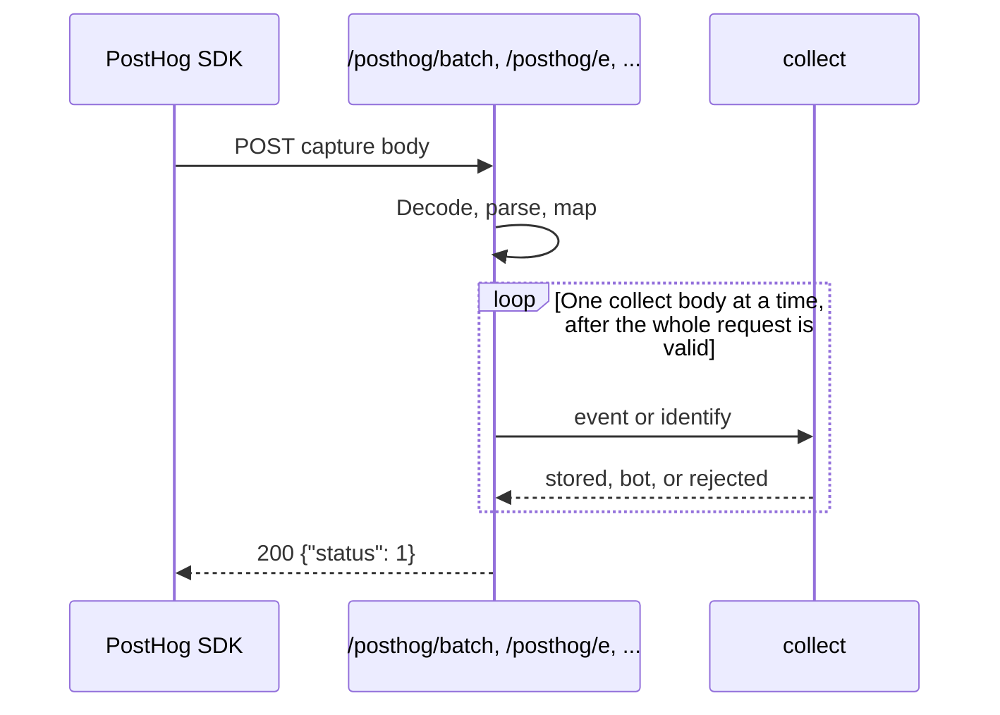
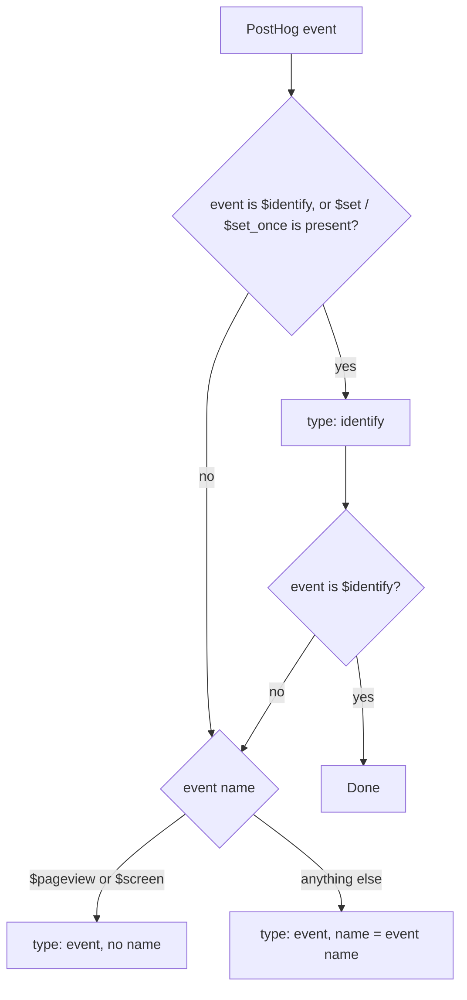

# PostHog to Umami mapping

The bridge lets a PostHog SDK use this Umami server as its capture host. It decodes the PostHog body, translates each event into a collect object, and calls the existing collector in process. It does not insert rows itself, and it does not make an HTTP call to `/api/send`.



Implementation:

| Piece                                        | File                                                                |
| -------------------------------------------- | ------------------------------------------------------------------- |
| Paths and capture vs engage                  | `src/server/posthog/lib/paths.ts`                                   |
| Gzip, base64, and form decode                | `src/server/posthog/decode.ts`                                      |
| JSON to capture events                       | `src/server/posthog/protocol.ts`                                    |
| Mapping decisions                            | `src/server/posthog/lib/policy.ts`                                  |
| Capture event to the Umami body              | `src/server/posthog/translate.ts`                                   |
| The only call into the collector             | `src/server/posthog/submit.ts`                                      |
| HTTP handler                                 | `src/server/posthog/handle.ts`                                      |
| Route entry and trailing-slash helper        | `src/server/posthog/index.ts`                                       |
| Collector used by `/api/send` and the bridge | `src/server/collect.ts`                                             |
| Routes                                       | One file per suffix under `src/app/posthog/`                        |
| Trailing-slash rewrite                       | `src/middleware.ts`, and `docker/middleware.ts` in the Docker image |

Each route file is `batch`, `e`, `capture`, `track`, `engage`, or `i/v0/e`. It re-exports `GET`, `POST`, and `OPTIONS` from `src/server/posthog`. `OPTIONS` returns `{ "status": 1 }`. The handler reads the path to choose capture or engage. A path that is not one of those suffixes has no route, so Next returns 404. The file layout is drawn in `src/server/README.md`.

## Client setup

Use the Umami website UUID as the PostHog project token. Set `api_host` to this server's `/posthog` prefix. The SDK appends `/batch/`, `/e/`, and the other capture paths itself.

```javascript
posthog.init('af94323e-95b5-4831-90fa-b757b9f32030', {
  api_host: 'https://your-umami-host/posthog',
});
```

A `phc_...` project token is rejected with `401` and `API key is not valid`. There is no token-to-website table.

## Paths

The SDK path is relative to `api_host`. On this server that lands under `/posthog`. Middleware rewrites a trailing slash internally, so `POST /posthog/batch/` does not become a `308` redirect. That matters for `sendBeacon`, which does not reliably follow redirects. CORS headers for these paths match `/api/*`: any origin, any header, and `GET`, `DELETE`, `POST`, `PUT`.

| SDK path                                        | This server                                                                             | Behavior                                              |
| ----------------------------------------------- | --------------------------------------------------------------------------------------- | ----------------------------------------------------- |
| `/batch`, `/i/v0/e`, `/e`, `/capture`, `/track` | `/posthog/batch`, `/posthog/i/v0/e`, `/posthog/e`, `/posthog/capture`, `/posthog/track` | Decode the body and translate every event.            |
| `/engage`                                       | `/posthog/engage`                                                                       | Same, and a missing `event` name becomes `$identify`. |
| `/flags`, `/decide`, `/s`, `/static/*`          | —                                                                                       | Not implemented.                                      |

Supported body shapes are the [four PostHog shapes](posthog-api.md#request-shapes): one event, a batch envelope, a raw array, and an `/engage` identify body. `historical_migration` is accepted and ignored.

## Decode order

1. Reject a body larger than 20MB with `413`.
2. If the content type is form-urlencoded, read the `data` field. The form's own `compression` field is used when the query did not set one.
3. If the body is empty, read the `data` query parameter. A missing one is `400` `request missing data payload`.
4. `base64` or `b64` is base64-decoded. `lz64` or `lz-string` is `400` `unsupported compression`.
5. Gzip is applied when the bytes start with `1f 8b`, when `Content-Encoding` contains `gzip`, or when `compression` is `gzip` or `gzip-js`. Base64-wrapped gzip is detected. A gzip hint on a body that is already JSON is left as JSON.
6. The result is parsed as JSON. Invalid JSON is `400` `failed to parse request`.

## Event translation

Each PostHog event becomes one or two collect objects. Identify is emitted first when person properties are present, then the event. `$identify` emits identify only. The identify call carries the same URL, referrer, hostname, language, screen, IP, and user agent as the event. Umami copies those onto the session when the session row is first created, and it does not update that row afterwards.



| PostHog event                                                                                           | Umami `type`             | Umami `name`                           | How it shows up                                                                 |
| ------------------------------------------------------------------------------------------------------- | ------------------------ | -------------------------------------- | ------------------------------------------------------------------------------- |
| `$pageview`                                                                                             | `event`                  | omitted                                | Pageview                                                                        |
| `$screen`                                                                                               | `event`                  | omitted                                | Pageview whose URL is the screen name when no page URL was sent                 |
| `$identify`                                                                                             | `identify`               | —                                      | Session properties from `$set` and `$set_once`                                  |
| Any other name, including `$pageleave`, `$autocapture`, `$create_alias`, `$groupidentify`, `$exception` | `event`                  | The PostHog name, cut to 50 characters | Custom event                                                                    |
| Custom event that also has `$set` or `$set_once`                                                        | `identify`, then `event` | The PostHog name on the event          | Session properties, then the custom event                                       |
| `$performance_event`                                                                                    | —                        | —                                      | Dropped. A request that contains only these returns success and writes nothing. |

`$create_alias` does not merge sessions. `$groupidentify` does not create a group record. Both are stored as named events so the payload is not discarded. `$pageleave` is a named event on purpose: treating it as a pageview would count the page twice.

## Field mapping

| PostHog                                | Umami payload     | Rule                                                                                                                                                                                   |
| -------------------------------------- | ----------------- | -------------------------------------------------------------------------------------------------------------------------------------------------------------------------------------- |
| `api_key`, `token`, or `$token`        | `website`         | Must be a UUID. One token per request. Batch token and event token must match.                                                                                                         |
| `distinct_id` or `$distinct_id`        | `id`              | Top level wins over `properties`. Strings are trimmed. Numbers and booleans are stringified. Cut to 50 characters unless `CLICKHOUSE_URL` is set, in which case the cut is 200.        |
| `timestamp`, `offset`, `sent_at`       | `timestamp`       | Unix seconds. See the formula below. Omitted when the client sent no timestamp, and Umami then uses its own clock.                                                                     |
| `$current_url`                         | `url`             | First choice.                                                                                                                                                                          |
| `$host` + `$pathname`                  | `url`             | Used when `$current_url` is missing. An absolute URL is built when both are present.                                                                                                   |
| `$screen_name`                         | `url` and `title` | Used for `$screen` when no URL was sent. The URL is `/` plus the screen name.                                                                                                          |
| `$title`, then `title`                 | `title`           | Cut to 500 characters.                                                                                                                                                                 |
| `$host`                                | `hostname`        | Cut to 100 characters.                                                                                                                                                                 |
| `$referrer`, then `$referring_domain`  | `referrer`        | A bare domain such as `google.com` is sent as `https://google.com`.                                                                                                                    |
| `$browser_language`, then `$locale`    | `language`        | Cut to 35 characters.                                                                                                                                                                  |
| `$screen_width` and `$screen_height`   | `screen`          | `WIDTHxHEIGHT`, and only when that string matches digits, an `x`, and digits, and is at most 11 characters. `1920x1080` fits. Larger values are omitted rather than failing the event. |
| `$ip`                                  | `ip`              | Passed through only when it is a valid IP.                                                                                                                                             |
| `$raw_user_agent`                      | `userAgent`       | Passed through so server SDKs can keep the end-user agent. Otherwise Umami reads the request `User-Agent`, which for a server SDK is the SDK itself.                                   |
| `properties`                           | `data`            | See the property rules below.                                                                                                                                                          |
| `$utm_*` or `utm_*`, and the click ids | appended to `url` | Added only when that key is not already in the query string. Umami's collector then reads them from the URL.                                                                           |

The session key is `distinct_id`, because that is what Umami stores in the distinct-id column and what it hashes into the session id. `$session_id` is not used as the session key. On a custom event it remains inside `data` when the client sent it. On a pageview it is dropped with the other `$` properties.

Click ids copied onto the URL are `gclid`, `fbclid`, `msclkid`, `ttclid`, `li_fat_id`, and `twclid`, plus the same names prefixed with `$`. Campaign keys are `utm_source`, `utm_medium`, `utm_campaign`, `utm_term`, and `utm_content`.

### Properties kept in `data`

| Event kind                        | What is copied into `data`                                                                                            |
| --------------------------------- | --------------------------------------------------------------------------------------------------------------------- |
| Pageview (`$pageview`, `$screen`) | Keys that do not start with `$`. Automatic SDK fields stay out of event data. A user property such as `plan` is kept. |
| Custom event                      | All properties except the dropped keys below.                                                                         |
| Identify                          | Only the merged person object: `$set_once`, then `$set` overwrites the same keys.                                     |

These keys are never copied into event data:

| Dropped key                                                 | Why                                          |
| ----------------------------------------------------------- | -------------------------------------------- |
| `$set`, `$set_once`                                         | Already sent as the identify payload.        |
| `$elements`, `$elements_chain`, `$snapshot_data`            | Large autocapture and replay blobs.          |
| `distinct_id`, `$distinct_id`, `token`, `$token`, `api_key` | Identity and routing fields, already mapped. |

## Timestamp formula

```text
stored_seconds = floor((timestamp - offset + (server_now - sent_at)) / 1000)
```

| Input                   | How it is read                                                                                                                                                                                       |
| ----------------------- | ---------------------------------------------------------------------------------------------------------------------------------------------------------------------------------------------------- |
| `timestamp`             | ISO 8601, or a number. Above `1e12` means milliseconds. Otherwise seconds. A numeric string is treated as a number. Invalid values are `400` `event submitted with invalid timestamp`.               |
| `offset`                | Milliseconds subtracted from `timestamp`. Non-numeric values are ignored.                                                                                                                            |
| `sent_at`               | Event ISO value, then the batch ISO value, then the `sent_at` or `_` query value in milliseconds. Query values that resolve to the year 2020 or earlier are ignored. Invalid ISO values are ignored. |
| `$ignore_sent_at: true` | `sent_at` is not applied.                                                                                                                                                                            |
| No `timestamp`          | The field is omitted. `/api/send` uses the server clock.                                                                                                                                             |

`server_now` is the time the bridge handles the request. If the client clock is 10 seconds ahead, `timestamp` and `sent_at` are both 10 seconds ahead, and the subtraction removes that skew.

## Errors

The bridge checks the whole PostHog body before it writes anything. A collector rejection on the first event is returned as that status, and nothing is stored. If a later event fails after an earlier one was stored, the bridge returns `503` so the SDK retries. A retry can store the earlier events again, because the collector assigns a new event id each time. This is stricter than [`POST /api/batch`](umami-api.md#batch), which keeps going and returns `200` with an `errors` count.

A bot response from the collector is treated as success and the bridge still returns `{ "status": 1 }`. The hit is not stored. An `IGNORE_IP` rejection is `403` when it happens before any event is stored.

| Condition                                           | Status                                       | Body                                               |
| --------------------------------------------------- | -------------------------------------------- | -------------------------------------------------- |
| Accepted                                            | `200`                                        | `{ "status": 1 }`                                  |
| Accepted with `beacon=1`                            | `204`                                        | Empty                                              |
| Empty body and no `data` query                      | `400`                                        | `request missing data payload`                     |
| Invalid JSON, or a non-object event                 | `400`                                        | `failed to parse request`                          |
| Gzip that cannot be inflated                        | `400`                                        | `failed to decode request`                         |
| `lz64` or `lz-string`                               | `400`                                        | `unsupported compression`                          |
| Empty `batch` or empty array                        | `400`                                        | `request holds no event`                           |
| Missing event name, on a capture route              | `400`                                        | `event submitted with an empty event name`         |
| Missing or blank `distinct_id`                      | `400`                                        | `event submitted without a distinct_id`            |
| Bad `timestamp`                                     | `400`                                        | `event submitted with invalid timestamp`           |
| No token                                            | `401`                                        | `event submitted without an api_key`               |
| Token is not a UUID                                 | `401`                                        | `API key is not valid`                             |
| Mixed tokens                                        | `401`                                        | `batch submitted with inconsistent api_key values` |
| Body over 20MB                                      | `413`                                        | `maximum event size exceeded`                      |
| Collector rejected the first event                  | The collector status, usually `400` or `403` | The collector JSON body                            |
| Collector failure after an earlier event was stored | `503`                                        | `transient error, please retry`                    |
| Unexpected exception before any event is stored     | `500`                                        | `{ "error" }`                                      |
| Unexpected exception after an event was stored      | `503`                                        | `transient error, please retry`                    |

Parse errors and the retry response are `text/plain`. A collector rejection before any event is stored stays JSON.

## Worked example

PostHog batch:

```json
{
  "api_key": "af94323e-95b5-4831-90fa-b757b9f32030",
  "sent_at": "2024-04-03T12:00:00.000Z",
  "batch": [
    {
      "event": "$pageview",
      "distinct_id": "user_123",
      "timestamp": "2024-04-03T12:00:00.000Z",
      "properties": {
        "$current_url": "https://example.com/docs",
        "$host": "example.com",
        "$referrer": "https://google.com/",
        "$browser_language": "en-US",
        "$screen_width": 1920,
        "$screen_height": 1080,
        "$title": "Docs",
        "plan": "pro",
        "$utm_source": "newsletter"
      }
    },
    {
      "event": "signup",
      "distinct_id": "user_123",
      "properties": {
        "plan": "pro",
        "$set": { "email": "a@example.com" }
      }
    }
  ]
}
```

Collector calls, in order:

```json
{
  "type": "event",
  "payload": {
    "website": "af94323e-95b5-4831-90fa-b757b9f32030",
    "id": "user_123",
    "timestamp": 1712145600,
    "url": "https://example.com/docs?utm_source=newsletter",
    "hostname": "example.com",
    "referrer": "https://google.com/",
    "language": "en-US",
    "screen": "1920x1080",
    "title": "Docs",
    "data": { "plan": "pro" }
  }
}
```

```json
{
  "type": "identify",
  "payload": {
    "website": "af94323e-95b5-4831-90fa-b757b9f32030",
    "id": "user_123",
    "data": { "email": "a@example.com" }
  }
}
```

```json
{
  "type": "event",
  "payload": {
    "website": "af94323e-95b5-4831-90fa-b757b9f32030",
    "id": "user_123",
    "name": "signup",
    "data": { "plan": "pro" }
  }
}
```

The pageview has no `name`, so Umami stores a pageview. `plan` is kept because it does not start with `$`. `$utm_source` is moved onto the URL. The signup's `$set` becomes identify, and the signup itself stays a custom event. Both share `user_123`, so they land on the same Umami session.

## What is not mapped

| PostHog capability                                      | Result here                                                                                                                                     |
| ------------------------------------------------------- | ----------------------------------------------------------------------------------------------------------------------------------------------- |
| Feature flags and `/flags`                              | The SDK request fails. Event capture continues.                                                                                                 |
| Session replay and `/s`                                 | Not accepted.                                                                                                                                   |
| Surveys, heatmaps, and AI endpoints                     | Not accepted. A `$exception` or `$ai_*` event that arrives on `/batch` is stored as a custom event.                                             |
| Person profiles and anonymous `$process_person_profile` | No person store. The distinct id is the session key.                                                                                            |
| Alias merge                                             | The `$create_alias` event is stored. Sessions are not merged.                                                                                   |
| Groups                                                  | `$groupidentify` and `$groups` are event data only.                                                                                             |
| `$session_id` as the session boundary                   | The session follows `distinct_id`.                                                                                                              |
| Cache token                                             | The bridge does not return `x-umami-cache` to the SDK, and does not send it between events. The session id is still stable because `id` is set. |
| LZ-string bodies                                        | Rejected. Current SDKs use gzip.                                                                                                                |
