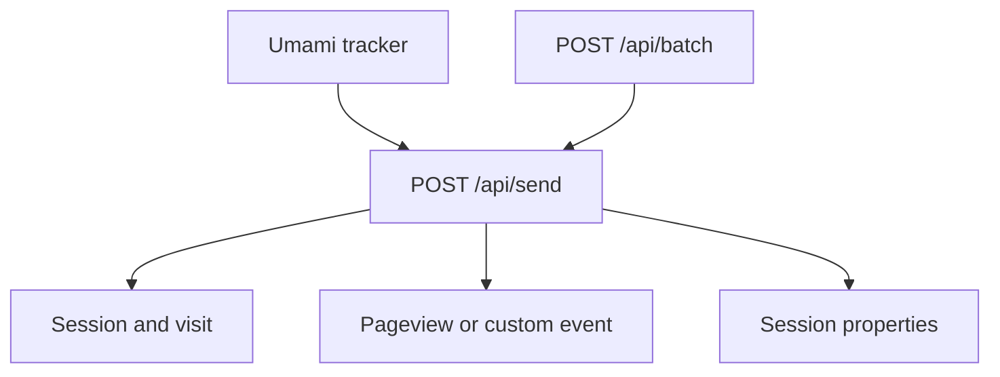
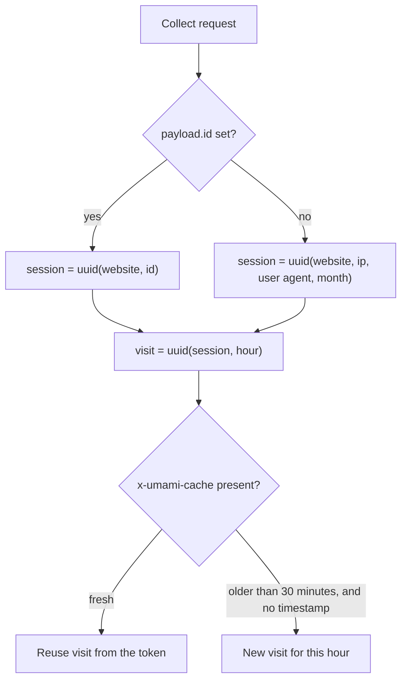

# Umami collection API

Umami records pageviews and events through two unauthenticated routes. The tracker posts one hit to `POST /api/send`. `POST /api/batch` accepts an array and runs each item through that same collector. The collector checks the payload, resolves the session, and writes the event.



`/api/batch` does not write on its own. Each array element is handled by the same function as `POST /api/send`, with the caller's headers preserved.

Dashboard, report, and team routes live under `src/app/api/` and require a logged-in user or a share token. This page does not describe them.

## Endpoints

| Method and path | Body | Success body |
| --- | --- | --- |
| `POST /api/send` | One collect object | `{ "cache", "sessionId", "visitId" }` |
| `POST /api/batch` | JSON array of collect objects | `{ "size", "processed", "errors", "details" }` |

Both skip auth. CORS for `/api/*` allows any origin, any header, and `GET`, `DELETE`, `POST`, and `PUT`.

`COLLECT_API_ENDPOINT` can rewrite another path onto `/api/send`. That rewrite is configuration, not a second collector.

## Collect object

```json
{
  "type": "event",
  "payload": {
    "website": "af94323e-95b5-4831-90fa-b757b9f32030",
    "url": "/docs",
    "hostname": "example.com",
    "referrer": "https://google.com/",
    "title": "Docs",
    "language": "en-US",
    "screen": "1920x1080",
    "name": "signup",
    "tag": "marketing",
    "id": "user_123",
    "timestamp": 1712145600,
    "ip": "203.0.113.8",
    "userAgent": "Mozilla/5.0",
    "data": { "plan": "pro" }
  }
}
```

`type` is `event` or `identify`.

| Field | Limit | Used for |
| --- | --- | --- |
| `website` | UUID | Website to store the hit on. Unknown ids return `400` with `Website not found.` |
| `url` | A URL or a path | Path, query, hash, UTM parameters, and click ids. A missing URL is stored as an empty path. |
| `hostname` | 100 characters | Overrides the host parsed from `url`. |
| `referrer` | A URL or a path | Referrer path, query, and domain. |
| `title` | Stored up to 500 characters | Page title. |
| `language` | 35 characters | Session language. |
| `screen` | 11 characters | Session screen, usually `WIDTHxHEIGHT`. Also used to classify desktop, laptop, tablet, and mobile. |
| `name` | 50 characters | Custom event name. Empty or omitted means a pageview. |
| `tag` | 50 characters | Event tag. |
| `id` | String. The relational column is `varchar(50)`. | Distinct id. When set, it is also the session key. |
| `timestamp` | Unix seconds | Event time. Omitted means the server clock. |
| `ip` | IP address | Overrides the address taken from proxy headers, and is used for geo lookup. |
| `userAgent` | String | Overrides the request `User-Agent`. Browser, OS, and device are parsed from it. |
| `data` | JSON object | Event properties for `type: "event"`. Session properties for `type: "identify"`. Nested objects are flattened. |

`data` values are stored by type: string, number, boolean, or date. Dates are strings that match the collector's datetime pattern.

UTM and click ids are not their own fields. `/api/send` reads them from the query string of `url`:

| Query key | Stored column |
| --- | --- |
| `utm_source`, `utm_medium`, `utm_campaign`, `utm_content`, `utm_term` | Matching `utm_*` column |
| `gclid`, `fbclid`, `msclkid`, `ttclid`, `li_fat_id`, `twclid` | Matching click-id column |

The path and query stored on the event are truncated to 500 characters. The page title is truncated to 500. The event name stored in the database is truncated to 50 even if validation already rejected a longer `name`.

## Sessions and visits



A session is a deterministic UUID:

- With `payload.id`, the session is `uuid(website, id)`. It stays the same for that distinct id. The monthly salt is not used.
- Without `payload.id`, the session is `uuid(website, ip, user agent, month salt)`. It changes at the start of each UTC month, and it changes if the IP or user agent changes.

The visit is `uuid(session, hour salt)`. The tracker sends back `cache` from the previous response in the `x-umami-cache` header. That token carries `websiteId`, `sessionId`, `visitId`, and `iat`. If the request has no explicit `timestamp` and the token is older than 30 minutes, the visit id is rotated. A request that includes `timestamp` does not rotate the visit that way.

On PostgreSQL and MySQL, the collector inserts the session row when the cache does not already name one. ClickHouse writes the event directly and does not take that insert branch.

Browser, OS, device, country, region, and city come from the user agent and IP. They are not fields on the collect object. Device classification uses `screen` plus the detected OS. Local IPs are not looked up in the geo database. When `ip` was not supplied in the payload, Cloudflare or Vercel location headers are used before the geo database.

Bots are detected with `isbot` on the user agent. A bot receives `200` and `{ "beep": "boop" }`, and nothing is written. Set `DISABLE_BOT_CHECK` to skip that check. Addresses listed in `IGNORE_IP`, including CIDR ranges, receive `403`.

## Event and identify

`type: "event"` writes one event.

| `name` | Stored event type | `event_name` |
| --- | --- | --- |
| Omitted or empty | Pageview (`1`) | `null` |
| Any other string | Custom event (`2`) | The name, truncated to 50 characters |

The hostname saved on the event is `payload.hostname`, or the host parsed from `url` with a leading `www.` removed. The URL path keeps its hash. `REMOVE_TRAILING_SLASH` strips a trailing slash from that path.

If `data` is present, each flattened key is written as event data on that event. A numeric `data.revenue` together with `data.currency` also writes a revenue row.

`type: "identify"` does not write an event. When `data` is present, those keys are saved as session properties for the same session id. An identify with no `data` still resolves the session and returns a cache token.

## Batch

`POST /api/batch` expects a JSON array. Each element is passed to `send.POST` with the original request headers, so IP and user agent still come from the caller.

The HTTP status stays `200` when individual items fail. The body reports how far it got:

```json
{
  "size": 2,
  "processed": 1,
  "errors": 1,
  "details": [{ "index": 1, "response": { "error": "..." } }]
}
```

Items before a failure are already stored. Later items are still attempted.

## Responses

| Status | Body | When |
| --- | --- | --- |
| `200` | `{ "cache", "sessionId", "visitId" }` | Stored, or identified with no properties. `cache` is the token the tracker should send back as `x-umami-cache`. |
| `200` | `{ "beep": "boop" }` | Request user agent was classified as a bot. |
| `200` | `{ "size", "processed", "errors", "details" }` | `/api/batch` finished. `errors` can be greater than zero. |
| `400` | `{ "error" }` | Payload failed validation, or the website UUID does not exist. |
| `403` | `{ "error" }` | Client IP is in `IGNORE_IP`. |
| `500` | `{ "error" }` | Unexpected failure while storing the hit. |

Validation errors name the field, for example `website: Invalid uuid` or `screen: String must contain at most 11 character(s)`.
