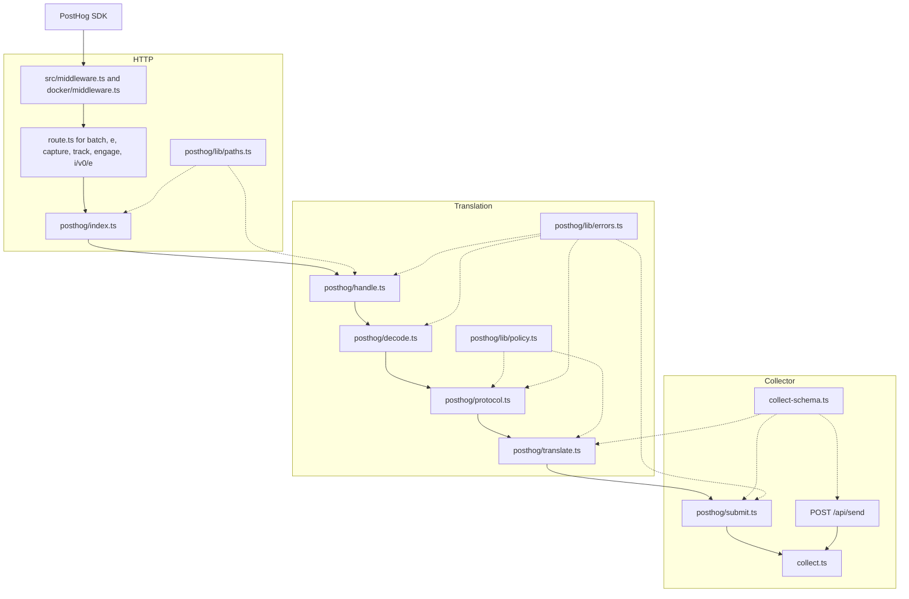

# Server layout

`collect.ts` is the Umami writer. The PostHog bridge reads an SDK request, translates it, and calls that writer. Solid arrows are the request. Dotted arrows are shared lookups.

`index.ts` re-exports the trailing-slash helper from `lib/paths.ts`. Both middlewares import that helper from `posthog/index.ts`. `decode.ts` turns gzip, form, and base64 into JSON. `protocol.ts` turns that JSON into PostHog events. `translate.ts` turns each event into the body `collect()` accepts. `submit.ts` checks every body, then writes.
